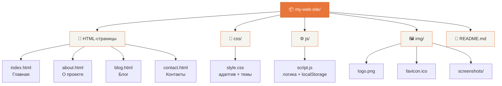

# 📷 Lens Studio — сайт-визитка фотографа

Статический сайт-визитка на чистом HTML, CSS и JavaScript. Тема — фотограф-портретист. Сайт разворачивается на GitHub Pages.

## 🚀 Функциональность
- ✅ Адаптивный дизайн (mobile-first, breakpoint 768px)
- ✅ Тёмная / светлая тема с сохранением в `localStorage`
- ✅ Избранные статьи блога (`localStorage`)
- ✅ Анимация появления секций при скролле (IntersectionObserver)
- ✅ Анимированные счётчики статистики
- ✅ Бургер-меню на мобильных
- ✅ Форма обратной связи с валидацией
- ✅ Единый header и footer на всех страницах
- ✅ Активные ссылки навигации

## 📁 Структура проекта

## 🌐 GitHub Pages
Сайт доступен по адресу: `https://vovych33.github.io/Lens_Studio/`

## 👥 Разработчик
- **Vovych33** — верстка, стили, JS, документация.

## 📄 Лицензия
MIT